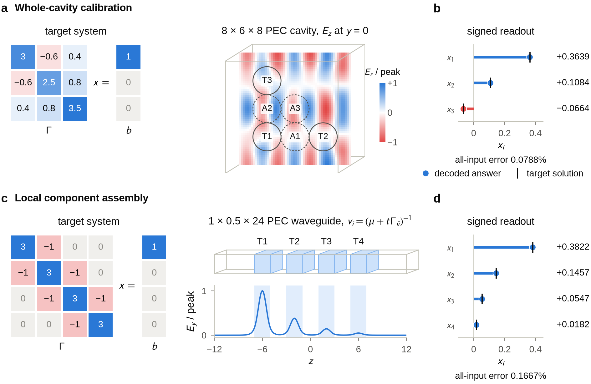

# Maxwell's equations are universal for sparse linear algebra

Companion material for *Maxwell's equations are universal for sparse linear
algebra*: manuscript sources, Lean developments, exact certificate checkers,
and numerical illustrations.

**Paper:** Y. Augenstein, *Maxwell's equations are universal for sparse linear
algebra*, [arXiv:2610.38913](https://arxiv.org/abs/2610.38913) (2026).



The paper gives a continuum construction with a bounded positive scalar
dielectric. The numerical studies illustrate parts of its mechanism at accessible
scales: a calibrated periodic cavity realizes a signed three-variable response,
and a waveguide control assembles several targets from one isolated-component
calibration. Their measured accuracy, refinement tests, and precision studies are
included alongside the unsuccessful compact periodic constructions.

## Start here

| Interest | Entry point |
| --- | --- |
| Read or build the paper | [Manuscript](paper/README.md) |
| Prepare the arXiv source ZIP | [Packaging command](paper/README.md#prepare-the-arxiv-zip) |
| Understand the calibrated cavity | [Device walkthrough](experiments/report/device_walkthrough/README.md) |
| Understand reusable local components | [Waveguide walkthrough](experiments/report/local_compilation/walkthrough/README.md) |
| Reproduce the numerical work | [Experiments](experiments/README.md) |
| Inspect or check the Lean development | [Lean](lean/README.md) |
| Replay the exact arithmetic certificates | [Certificate checks](certificates/README.md) |
| Understand what each artifact establishes | [Evidence and scope](docs/evidence.md) |

The two walkthrough directories contain standalone `preview.html` files. Open
them locally to change the input and inspect the material, sources, fields, and
readout. The displayed responses are reconstructed from saved Maxwell fields.

## A small first run

With Python 3.11 or newer and [uv](https://docs.astral.sh/uv/) installed, run from
the repository root:

```bash
uv run --script scripts/assets.py verify
mkdir -p build
uv run --script certificates/continuum/continuum_maxwell_three_halves_certificate.py \
  --output build/continuum-certificate.json
uv run --script experiments/waveguide_control.py calibrate \
  --output build/waveguide-calibration
```

The first command checks the imported files shipped in Git. The second replays
finite exact-rational identities used in the continuum argument. The third
recomputes an isolated waveguide component on the CPU. These are useful entry
points; their scopes are described in the linked guides.

## Source and large data

```text
paper/          Manuscript, supplementary information, and figure generators
lean/           Lean sources, audit entry points, and witness generators
certificates/   Continuum rational checks and discrete Yee certificate replay
experiments/    Solver code, frozen designs, measurements, and walkthroughs
docs/           Evidence map, reproduction guide, and snapshot provenance
data/           Checksums and archive inventory
scripts/        Archive installation and verification
```

The Git tree contains the readable sources, small inputs, reports, and figures.
Large field arrays, witness matrices, and generated Lean tables are distributed
as companion archives. Every archived file has a path and SHA-256 digest in
[`data/manifest.json`](data/manifest.json); installation restores the paths used
by the source code. All Lean source files in the imported snapshot are accounted
for, including generated modules and experimental developments.

See [reproduction](docs/reproduction.md) for archive selection, CPU and GPU
requirements, and complete replay commands. The formal development and numerical
experiments have different verification scopes; [the evidence map](docs/evidence.md)
states them explicitly.

## Citation

If you use this material, please cite the paper:

```bibtex
@misc{augenstein2026maxwell,
  title         = {Maxwell's equations are universal for sparse linear algebra},
  author        = {Augenstein, Yannick},
  year          = {2026},
  eprint        = {2610.38913},
  archivePrefix = {arXiv},
  primaryClass  = {physics.optics},
  doi           = {10.48550/arXiv.2610.38913},
  url           = {https://arxiv.org/abs/2610.38913}
}
```

[`CITATION.cff`](CITATION.cff) provides the same reference in machine-readable form.

## License

The manuscript sources and figures in `paper/`, and the numerical and certificate
data in this repository and its release archives, are licensed under
[CC BY 4.0](LICENSE-CC-BY-4.0). All other material, including the Python
scripts, checkers and Lean sources (also the generated modules in the
`lean-generated` archives), is licensed under the [MIT License](LICENSE).
