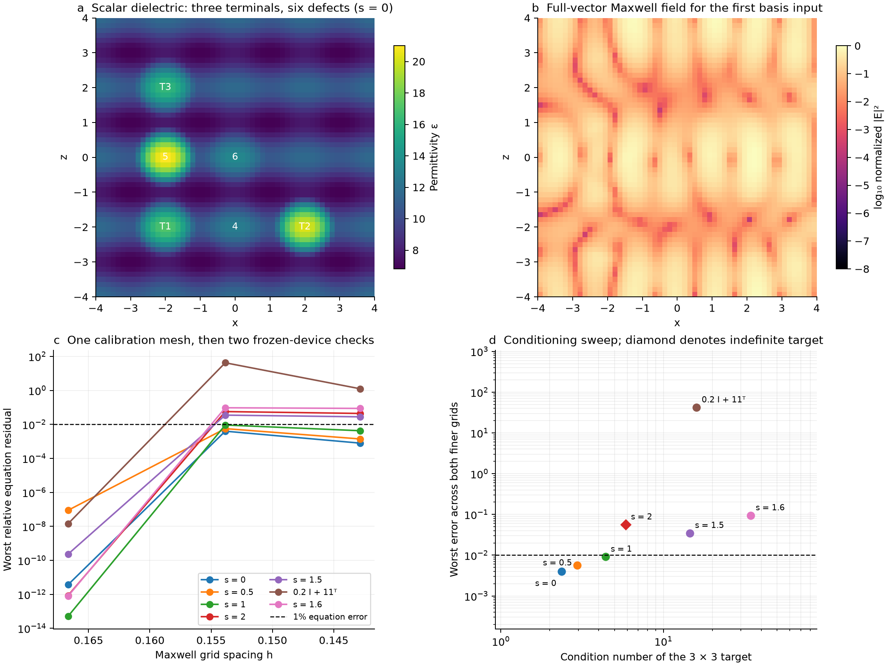
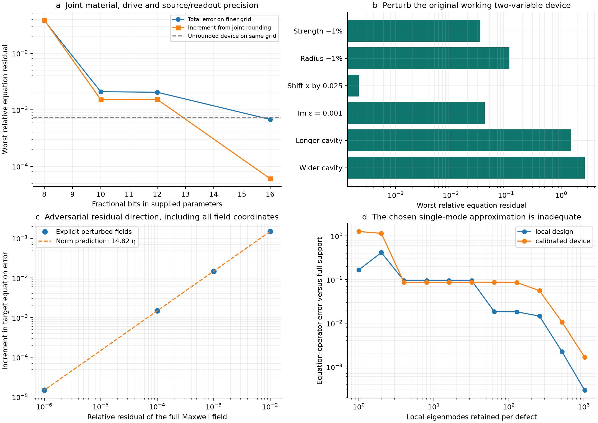
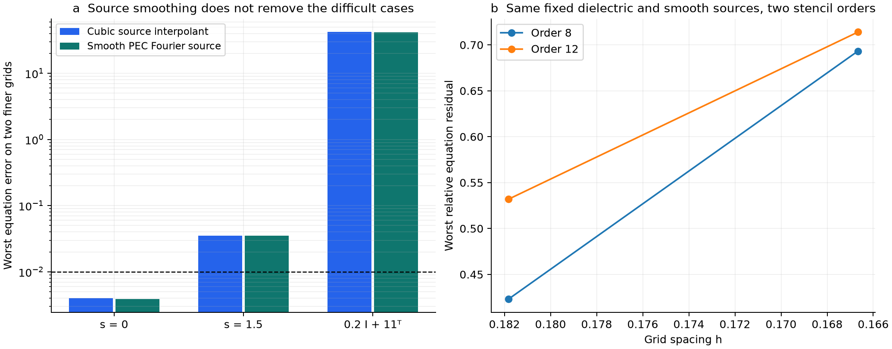

# Extended Maxwell implementation study

The study now includes **seven prescribed three-variable designs**, a joint finite-precision input test, material and geometry perturbations, and an adversarial field-residual experiment. **3 of the seven final designs have less than 1% worst-case equation error on both independent finer grids.** The best such two-grid result is 0.3966%. All targets and failed searches are retained. This is numerical evidence for calibrated dielectric designs, not manufactured hardware, a continuum certificate, or the theorem's scalable local encoder.

## What is stronger than the original demonstration

The full-vector, lossless PEC equation is solved with bounded scalar dielectric, all polarizations and gradient channels present, and no momentum filter. Three independent source fields span every right-hand side of each target; the reported error is the operator norm `||Γ X − I||₂`, not an average over selected inputs. The grid grows from 237,444 unknowns at calibration to 302,991 and 379,610 for independent verification. Material strengths, continuous source/readout functions, drive gain and decoder are frozen across these checks.

The six defects occupy the same `8 × 6 × 8` cavity in every three-variable case. The signed target family is

`Γ_s = [[3, −0.6, 0.4], [−0.6, 2.5, 0.8], [0.4, 0.8, 3.5]] − s I`,

with `s = 0, 0.5, 1, 1.5, 1.6, 2`. The last is indefinite. The additional target `0.2 I + 11ᵀ` has condition number 16. These matrices were supplied to the calibration procedure; none was defined by inverting a measured device response. The shift family was added after the original signed case succeeded, so it is an adaptive extension, not an independently blinded matrix sample.

Full-background calibration supplies the initial designs. Final tuning changes only the six material amplitudes using full Maxwell solves and the exact discrete derivative `dX/dv_i = Eᵀ W_i E / α`. Source profiles, source gains and the decoder remain fixed even during this final tuning. A separate finite-difference material perturbation checks this derivative to 5.17e-06 relative difference. No inverse of the target appears in source programming or decoding. Calibration itself is expensive global inverse design, and its cost is not claimed to be smaller than solving the input system.

| Target | κ₂(Γ) | Type | Calibration h=1/6 | Frozen h=2/13 | Frozen h=1/7 | Calibration reached 1e−7 |
| --- | ---: | --- | ---: | ---: | ---: | --- |
| s = 0 | 2.37 | positive definite | 3.676e-10% | 0.3966% | 0.07878% | yes |
| s = 0.5 | 2.95 | positive definite | 8.762e-06% | 0.5616% | 0.1386% | yes |
| s = 1 | 4.41 | positive definite | 5.08e-12% | 0.915% | 0.4226% | yes |
| s = 2 | 5.87 | indefinite | 8.512e-11% | 5.642% | 4.383% | yes |
| s = 1.5 | 14.5 | positive definite | 2.308e-08% | 3.489% | 2.777% | yes |
| 0.2 I + 11ᵀ | 16 | positive definite | 1.419e-06% | 4197% | 124.6% | yes |
| s = 1.6 | 34.4 | positive definite | 7.846e-11% | 9.461% | 8.67% | yes |

The field image is one actual basis-source solve. Its cell-centred intensity interpolation is for visualization; quantitative residuals use the original staggered fields. Changing the verification grid does not retune the material or rebuild its source functions.

## Precision and robustness are now measured

These controls use the **original two-variable working device**, not the new three-variable family. The joint rounding test applies spacing `2^(−bits)` to the background constant, every defect strength, drive gain and every physical spline sample specifying source/readout profiles. Geometry, the analytic cosine/bump functions and solver arithmetic are unchanged. It is a finite parameter-precision test, not a measurement of asymptotic `O(log m)` bit complexity.

| Fractional bits | Total equation error on h=1/6 | Additional equation-operator error from rounding |
| ---: | ---: | ---: |
| 8 | 3.808% | 3.882% |
| 10 | 0.2088% | 0.1521% |
| 12 | 0.2044% | 0.153% |
| 16 | 0.06759% | 0.006054% |

The extra-error column compares to the unrounded device on the **same** grid, avoiding credit for accidental cancellation of discretization error. At 16 bits the rounding increment is 0.006054%.

For arbitrary full-field residuals, reciprocity gives a discrete recovery norm. Explicitly constructed perturbations attain the measured factor **14.82**: a relative Maxwell residual η causes a target-equation error increment of 14.82η in the worst tested direction. The residual direction spans the complete electric field space, including components outside the source/probe span. This checks recovery sensitivity at one finite discretization; it does not certify continuum conditioning or its dependence on problem size.

For the same original device, a uniform −1% strength perturbation gives 3.42% equation error, shrinking radii by 1% gives 11.5%, and adding imaginary permittivity 0.001 gives 4.11%. The absorbing control lies outside the lossless theorem. Changing the longitudinal or transverse PEC walls gives errors of 150% and 266%. The designs depend on the whole cavity; locality and fabrication tolerance have not been established by good nominal accuracy.

## Failures that constrain the interpretation

The originally prescribed unequal positive target `[[4,1,0.5],[1,3,0.75],[0.5,0.75,2.5]]` did not reach the calibration criterion in the recorded six-site searches. Adding two material sites improved its best calibration error to about 5.17%, but still failed. These are failed bounded searches, not a proof that the target cannot be realized. They rule out describing this experiment as an arbitrary-matrix compiler.

The initial single-mode local gadget remains inaccurate. A controlled truncation retaining the selected port mode and then local modes in decreasing absolute compressed-resolvent eigenvalue converges slowly: hundreds of modes are needed in this particular basis. The full 1,494 coordinates per defect recover the exact finite-support response. This does not prove that every possible reduced basis needs that many modes. Direct terminal coupling and discarded-mode corrections are both measured; the implementation retains them in global calibration rather than asserting locality.

An exact fit on a calibration grid is insufficient. The original coherent condition-16 target had about 96% error after refining its coarse calibration. Even calibration at h=0.2 left roughly 66% error at h=2/13 before the final material-only correction above. These failed stages are preserved in `network_free_scale` and `network_fine`.

Two further controls test implementation alternatives. The smooth-source variant uses a fixed finite sine/cosine expansion compatible with the PEC grid, multiplied by the compact smooth bump. It is infinitely differentiable and reproduces the reference source samples to 2.38e-14 relative error. It does not restrict the operator's modes. Repeating calibration and refinement for three targets changes the errors only modestly; the source interpolation is not the main explanation of the difficult cases.

The twelfth-order stencil uses exact rational Lagrange derivative coefficients rounded once to floating point. A variable-material analytic cavity solution gives observed convergence order 11.880, with zero measured curl-gradient product. An independent higher-order calibration of the coherent condition-16 target at h=0.2 still gives errors of 53.2% and 71.4% on h=2/11 and h=1/6. The plot compares both stencil orders on that **same final dielectric, source and decoder**. Neither a smoother source nor this order increase establishes accuracy for this case.

## Full-matrix spectral diagnostics

Shift-invert Lanczos acts on the complete assembled Maxwell operator, independently of the terminal response. The table gives numerical estimates and directly evaluated eigen-residuals, not certified spectral enclosures or continuum bounds.

| Saved case | Estimated nearest eigenvalue to zero | Absolute eigen-residual | Estimated matrix κ₂ |
| --- | ---: | ---: | ---: |
| results/robustness/nominal | 0.004857 | 6.61e-14 | 1e+05 |
| results/network_fine/conditioned_spd/h0.2 | 3.233e-05 | 7.27e-14 | 1.5e+07 |
| results/network_fine/conditioned_spd/h0.15384615 | 8.68e-05 | 1.15e-13 | 9.55e+06 |
| results/direct_refinement_b/conditioned_spd/h0.15384615 | -8.358e-07 | 7.46e-14 | 9.92e+08 |

The final coherent design is especially informative: its target has condition number 16, but its full Maxwell matrix on the failing `h=2/13` mesh has estimated condition number 9.92e+08. A near-zero eigenvalue -8.36e-07, with absolute eigen-residual 7.46e-14, has normalized source overlap 0.01359. This is evidence of a resonance coupled to the sources, consistent with the large response error. The calibration controls the terminal response at one mesh without imposing a lower bound on the full operator's distance from singularity. A successful fit therefore does not establish the stability needed for a general implementation.

Matrix condition numbers also include the mesh-dependent largest curl eigenvalue; they are not themselves continuum resolvent norms. See the saved spectra for source overlap and inverse-solve residuals. Two earlier spectral-diagnostic attempts failed in wrapper handling (RHS strides and an object lifetime); they produced no spectral conclusions and are not included above.

## Reproduction and evidence

[Protocol and commands](../README.md), [full Maxwell tuning](../refine_device.py), [precision experiment](../precision.py), [robustness experiment](../robustness.py), [spectral diagnostic](../conditioning.py), and [machine-readable extended results](extended_summary.json) accompany this report. Regenerate the figures and report with `uv run --script analyze_extended.py`.

The extended runs used one GPU per job with two host numerical-library threads per job. Dense calibration used CuPy/cuSOLVER; sparse field solves used cuDSS. The 379,610-unknown case was admitted after cuDSS's memory plan estimated 112.6 GB peak device memory, within the allocated device memory. The twelfth-order test also had a checked memory plan (100.8 GB at its largest grid). These are resource records, not performance benchmarks. Run directories preserve source snapshots, dependency versions and raw field outputs. All failed scientific candidates remain in the record. [Independent raw-field audit](full_field_audit.json) reconstructs source programming, decoding and two-curl PDE residuals directly from saved fields.
