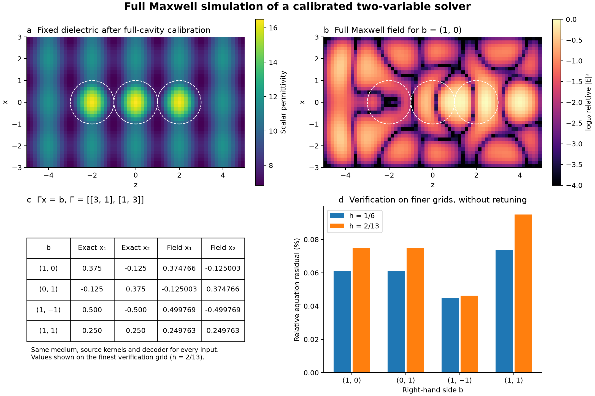
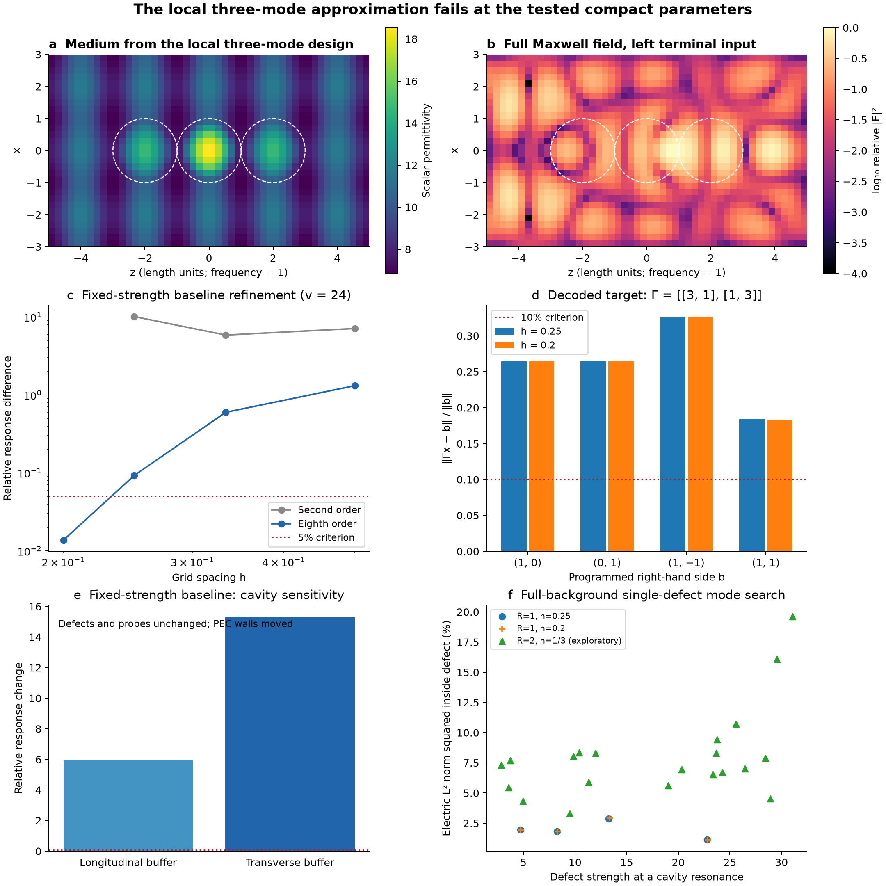

# Three-defect Maxwell feasibility experiment — 29 October 2026

The full vector implementation and first numerical study are complete. **A three-defect dielectric, calibrated against the full cavity response, solves a fixed two-variable system with less than 0.1% relative equation residual on finer grids without retuning.** The simple local-gadget approximation fails at these compact parameters. These are distinct findings: the first is a numerical small-device demonstration; the second identifies an obstacle to reusable local compilation. Neither is a certificate for the continuum theorem. No manuscript files were changed.

## Positive control: a fixed physical device

The target is `Γ = [[3,1],[1,3]]`. Full-cavity calibration changes only the three scalar defect strengths to `[12.500054068969126, 12.82462367451358, 12.500054068969126]`. The continuous material lies within `[4.772534429548964, 16.490449820163068]`. Source programming and decoding remain local linear operations; no target solve is used during those operations.

Calibration uses the entire finite-support background response and therefore **does not establish the theorem's scalable local encoder**. It takes five Newton updates to fit the target Schur complement. An independent full Maxwell solve then verifies the device. The near-machine-precision residual on its calibration grid is not treated as independent continuum evidence.

For that evidence, the material, source functions and decoder are frozen. Each source/readout function is explicitly defined as the analytic compact bump times a fixed cubic cardinal-spline interpolant of its reference background mode. The two verification grids have 222,180 and 283,556 electric unknowns. Their worst-case residuals for the measured linear two-port response are **0.0736% and 0.0950%**, respectively. This is numerical refinement evidence for a small calibrated continuum device, not a rigorous continuum error enclosure or a hardware demonstration. Fabrication tolerance and buffer robustness of this specifically retuned device have not been established by the baseline controls below.

## Local-gadget diagnostics

Panels a, b and d use the local three-mode design. Panels c and e use the separate fixed-strength baseline (`v_i=24`) and Bloch-envelope probes; panel c uses the eighth-order `h=1/6` result as its numerical reference. Panel f searches single-defect resonances. None of these baseline sensitivity measurements is a measurement of the separately retuned device above.

## What was actually implemented

The physical solve is `(curl curl - epsilon) E = f` at frequency and permeability one, with real scalar positive dielectric and PEC boundaries. All vector components, gradient modes and other wave channels are present. The original compatible second-order Yee implementation is retained as a comparison; the production study uses an eighth-order compatible staggered curl and point evaluation of the same smooth scalar material. No selected-band filter or three-mode operator replaces the full Maxwell solve.

The baseline has a `6 x 6 x 10` cavity, radius-one defects at `(0,0,-2)`, `(0,0,0)`, `(0,0,2)`, background modulation 0.5 and detuning 0.3. Fixed-strength measurements use strength 24. The calibrated modal experiment chooses three strengths from independent single-defect background modes; its resulting material bounds are saved in each receipt.

Two distinct reduced models are tested. The initial `gadget` command predicts the operational volume-moment response from single and pair devices. That is a portability diagnostic, **not** the proof's defect-polarization matrix. The `modal` command uses the appropriate matrix `T = V^-1 - Q A_background^-1 Q`, calibrates the actual full-background single-defect modes, and then tunes the intended nearest-neighbour three-mode Schur complement to `alpha * Γ`, where `Γ = [[3,1],[1,3]]`.

For each of four right-hand sides, it programs `r_terminals = alpha*b`, `r_mediator = 0`, drives the physical source `f = B V r`, and decodes `x = (V r + V B^T E)_terminals`. Here `B = Q U` consists of compact volume templates. **No solve of Γ is used in source programming or decoding.** The same material handles all four right-hand sides by linear superposition of separately computed full-field responses. Calibration solves the background Maxwell problem and is fully included in the recorded computation; this is a three-site experiment, not the uniform arbitrary-matrix compiler.

## Measured outcome

| Modal case | Programmed strengths (left, middle, right) | Largest decoded relative residual | Direct / neighbour background coupling | Full-support identity error |
| --- | --- | ---: | ---: | ---: |
| modal_h025 | 8.4624, 19.396, 8.4624 | 0.3256 | 0.5138 | 3.21e-15 |
| modal_h02 | 8.482, 19.449, 8.482 | 0.3261 | 0.5111 | 1.65e-15 |
| modal_radius2_h0333 | 15.774, 30.266, 15.774 | 0.8793 | 3.755 | 1.92e-14 |

Each modal receipt also compares the nearest-neighbour approximation with the model retaining all three pair interactions. The actual Maxwell response is independently checked against the **full-support** compressed resolvent, including every defect coordinate. Agreement there separates numerical/algebraic correctness from failure of the single-mode and locality approximations.

For the fixed-strength baseline (`v_i=24`, original Bloch-envelope probes), changing only the longitudinal cavity buffer changes the response by 5.94 times its original norm; changing the transverse buffer changes it by 15.3. These are different lossless cavities. The measurement tests whether their response near the same defects is insensitive to distant walls; it is not.

The full-background central-defect search numerically enumerates every positive compressed-resolvent eigenvalue whose resonant strength lies in the conservative material-admissible interval. At radius one, the most confined computed mode has only **2.93% of `||E||_2^2` inside the defect**, versus 2.88% on the preceding mesh. This diagnostic does not depend on selecting the initial Bloch readout template. The exploratory radius-two search reaches 19.62%, but changes radius, cavity size and detuning together and has not completed a refinement study. It does not isolate the effect of radius alone. These fractions are **unweighted electric-field L2 norms squared**, not total electromagnetic energy or radiated-power fractions.

## Numerical checks and their limits

- The analytic, variable-material PEC cavity test gives observed order 7.968; `curl grad = 0` and operator symmetry are checked. Second-order validation is also retained.
- CPU SuperLU and GPU cuDSS response matrices agree to 8.75e-14 relative error on the same coarse matrix. All accepted physical solves meet the `1e-8` discrete residual threshold. The failed low-order-preconditioned GMRES experiment is retained in `results/triple_o8_gmres_h05` and excluded from physical conclusions; its source snapshot preserves the attempted method.
- The fixed-strength baseline response changes by 1.38% between `h=0.2` and `h=1/6`. Its inverse response changes by 5.3%, and the extracted bypass ratio by 6.81%. Thus the response is substantially better resolved than on the initial meshes, but not every interaction metric meets the prospective 5% refinement gate.
- Modal designs are recalibrated on each mesh; those rows are consistency checks of the calibration, not a fixed-material convergence proof. The radius-two and changed-detuning variants are exploratory. Small residuals certify solutions of the discretized systems, not rigorous continuum error bounds.
- Uniform ±1% strength changes and absorption diagnostics are recorded in `summary.json`. Absorbing media are separate controls outside the lossless theorem.

## Consequence for the implementation effort

The infrastructure now generates a scalar medium, calibrates modes and couplings, programs sources, solves the full field, reads volume moments, and decodes a concrete two-variable target. The full-cavity control succeeds for that target; the simpler local construction does not. The diagnostics distinguish wall sensitivity, direct bypass and discarded-mode effects. Scaling up a compiler on the local approximation would not yet be justified.

The next useful research step is to obtain a physically useful single-defect mode and interaction hierarchy at manageable scales, then repeat this protocol. Larger, smoother defects and a better-separated practical band regime are candidates. A different language alone would not fix the measured locality problem. The original theorem's sufficient constants, its asymptotic bounds, an arbitrary sparse-system compiler, fabrication, and hardware speed or energy advantage remain outside this experiment.

## Reproduction and artifacts

See [the protocol](../README.md), [solver](../maxwell.py), and [sequential GPU suite](../run_suite.py). [Summary JSON](summary.json) and [case table](case_metrics.csv) are generated directly from result receipts. Each recent run retains its exact executed source and dependency versions; process receipts contain commands and exit status. Each job used one GPU, with two host numerical-library threads and no concurrent experiment jobs. Timings are resource records, not a solver performance benchmark. Run `uv run --script analyze.py` to regenerate this report and its [vector figure](three_defect_results.pdf).
