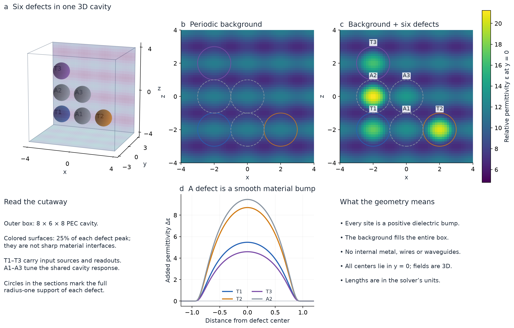
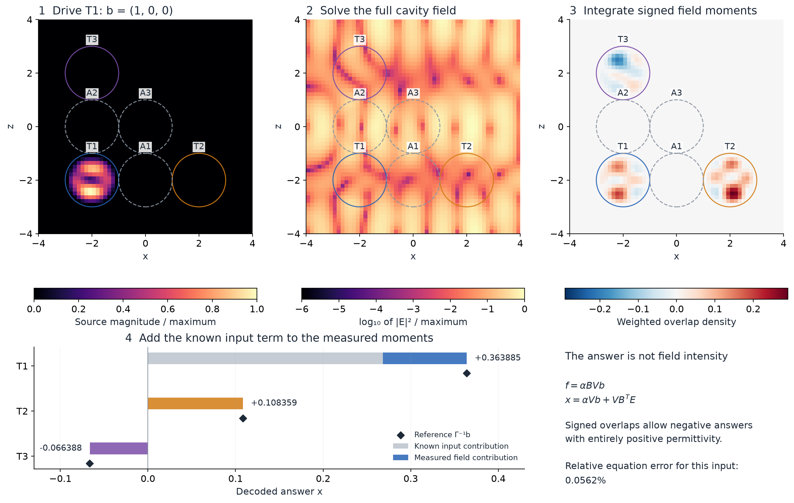
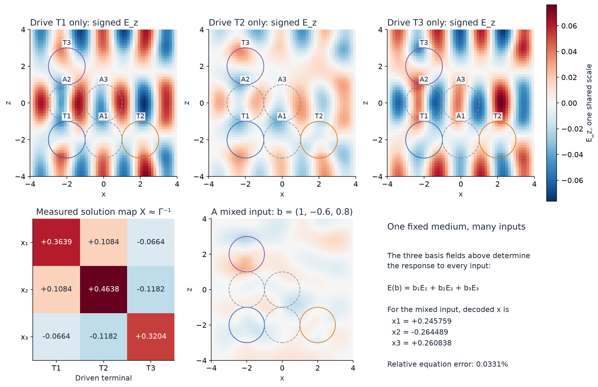

# Reading the six-defect device

These views explain the working signed three-variable example from the extended study. All fields come from the saved full-vector Maxwell solve at `h=1/7` (379,610 electric unknowns). They show this compact, globally calibrated prototype, whose parameters differ from the asymptotic construction in the paper.

## What is in the cavity



The box is `8 × 6 × 8` in the solver's nondimensional length units, with perfectly conducting outer walls. A periodic, positive scalar dielectric fills the entire volume. Six smooth spherical additions to that material form the defects. T1–T3 carry source and readout functions; A1–A3 change the coupled cavity response without being externally driven. There are no wires or internal metal walls. All centers lie in `y=0`, but the material bumps and solved fields are three-dimensional.

Colored spheres in the cutaway are the surfaces where each defect's added permittivity is 25% of its own peak. They are visualization contours, not sharp material interfaces. The outlined circles in cross-sections mark the full radius-one support of each bump. The continuously specified material remains in `[4.7725, 21.2319]` everywhere; the color scale includes an analytic enclosure, not just sampled extrema.

## How an input becomes an answer



The prescribed target is

```
Γ = [ 3.0  -0.6   0.4 ]
    [-0.6   2.5   0.8 ]
    [ 0.4   0.8   3.5 ]
```

1. The input vector `b` sets three coefficients of fixed, compact volume-source functions. With the saved terminal profiles collected in `B`, their fixed gains in the diagonal matrix `V`, and gain `α`, the source is `f = α B V b`. A negative coefficient reverses the corresponding source phase.
2. The full Maxwell operator of the fixed dielectric determines `E`. The response extends across the cavity and includes all polarizations. The plots are stationary phasor fields, not time-domain propagation or trajectories of energy flow.
3. The readout forms signed volume overlaps `Bᵀ E`. In the saved discretization, both arrays carry the square root of cell volume, so this dot product approximates the physical volume integral. The same profiles are used for source programming and reciprocal readout.
4. Multiplication by the fixed diagonal gains and addition of the known input term give `x = α V b + V Bᵀ E`. These are local multiplications and additions, with no solve of Γ inside the source or decoder. The direct input term is shown separately in the bar chart.

For `b=(1,0,0)`, the decoded answer is approximately `(0.363885, 0.108359, −0.066388)`, with relative target-equation residual `0.0562%`. Positive material does not imply positive field overlaps or positive answers. Intensity alone cannot perform this signed readout. The mathematical source/readout profiles have not been converted into fabricated launchers or detectors.

## One medium, different inputs



The three solved basis fields determine any input by linear superposition. The mixed-input field is combined **before** computing its magnitude, so interference is retained. Its decoded answer is also formed from the measured response, not substituted from the exact inverse of Γ. The exact algebraic solution appears only as a comparison in the operation figure.

The interactive walkthrough has four stages: material, source magnitude, signed `E_z`, and signed readout-overlap density. Input switching changes sources and fields while keeping the material fixed. The field and overlap color scales are normalized to the selected input's peak and expose spatial shape and sign, not absolute-amplitude comparisons between inputs. The static basis-field figure uses one common scale for comparing amplitudes.

## Reproduction and evidence

Run from the experiment directory:

```bash
uv run --script visualize_device.py
# Also regenerate the interactive fragment in a chosen durable location:
uv run --script visualize_device.py --inline-output /absolute/path/maxwell-device-walkthrough.html
```

The three figures are provided as PNG and PDF. `device_data.json` contains the reduced central-plane data used by the interactive view. `visualization_evidence.json` records the raw-field checksum, reconstruction checks, and displayed numerical answers.

For display only, staggered vector components are interpolated to cell centers and then to `y=0`. Readout density in a two-dimensional section illustrates the integrand; the actual decoder integrates the complete three-dimensional field. Quantitative answers and residuals use the original saved staggered fields without display interpolation. No additional physical solve or change to the manuscript was made for these figures.
