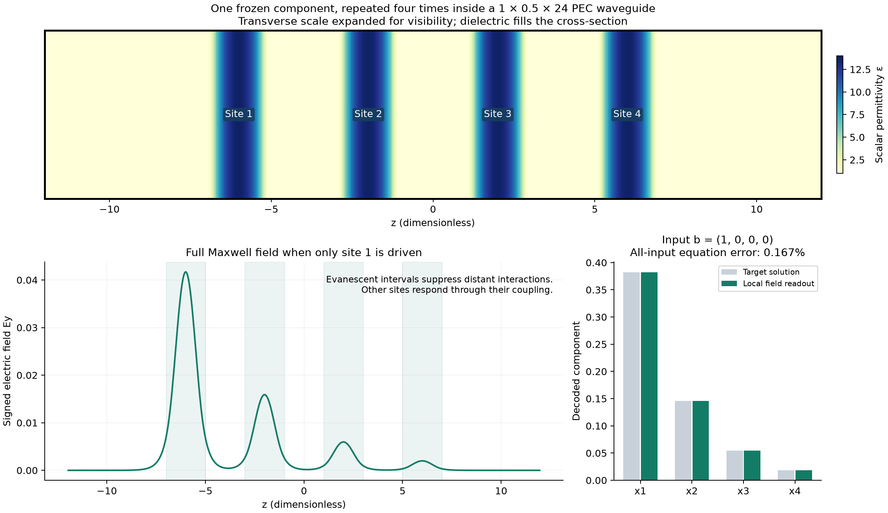
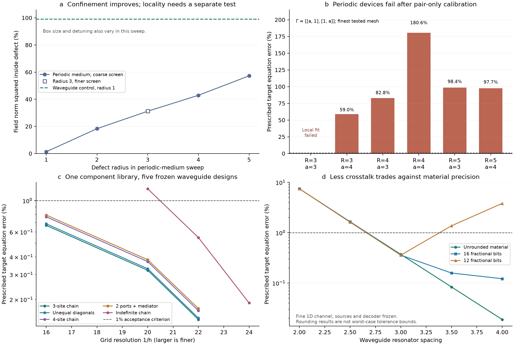

# Reusable local compilation: measured result and boundary

**Local compilation now succeeds for a restricted waveguide-chain control. It still fails in the compact three-dimensional periodic geometry.** Five prescribed waveguide targets use the same isolated-component calibration, with no whole-device optimization. Every target has less than 0.55% worst-case equation error on both of its finer full-vector Maxwell grids. This is numerical evidence for reusable components in a simpler physical platform; it is not an implementation of the paper's general sparse-system compiler.



The pictured target is the four-by-four matrix with diagonal 3 and nearest-neighbor entries −1. The plotted field is from the finest full-vector solve with input `(1,0,0,0)`. The ideal answer is computed only for comparison after the device has been designed and solved. Transverse dimensions in the material picture are expanded for visibility.

The [device walkthrough and significance notes](walkthrough/README.md) add component confinement, copied resonators, signed full-Maxwell fields, mediator operation, and the precision tradeoff, with PNG/PDF figures and source checks.

## What is reusable

The control is a rectangular PEC waveguide of cross-section `1 × 0.5`, with smooth dielectric wells of radius 1 along its length. Permittivity is uniform over each transverse cross-section. The exterior dielectric is 1; the largest permittivity in the five designs is approximately 13.644. Frequency and permeability remain 1. Thus the medium is scalar, positive, bounded and lossless.

This geometry has an invariant TE10 channel, with electric field proportional to `sin(pi*(x+0.5))` in the y direction. Its longitudinal equation is

`[-d²/dz² + pi² - epsilon(z)] e(z) = f(z)`.

In the background, the field decays at rate `kappa = sqrt(pi²−1) = 2.978188...`. This is ordinary waveguide cutoff, a different confinement mechanism from the paper's periodic Bloch construction. The standard cutoff relation and transverse mode shape are described in [MIT's waveguide lecture](https://ocw.mit.edu/courses/6-013-electromagnetics-and-applications-spring-2009/MIT6_013S09_lec16.pdf).

One isolated well supplies a normalized local mode and its eigenvalue `mu = 0.02909782699697072`. About **99.00% of the unweighted electric-field L2 norm squared** lies inside that well. This fraction is not total electromagnetic energy. The source is a fixed smooth compact function reconstructed from that isolated mode; copies are translated to the other sites without recalibration.

The background Green function gives the pair coupling analytically. At spacing 4 it is `t = 1.2284541758091573e-6`. A separate two-site calculation agrees to relative error below `7e-13`. The coupling is about `8.56e-5` of the gap between the first two local compressed-resolvent eigenvalues.

For a path target with nearest-neighbor entries −1, the compiler uses the explicit rule

`v_i = 1 / (mu + t * Gamma_ii)`.

It inserts no measured response from the assembled device into this rule. The positive terminal coupling in the mediator example uses three reduced diagonal entries `(2,−1,2)`, whose ideal Schur complement is `[[3,1],[1,3]]`. The actual dielectric remains positive even though the mediator's reduced diagonal is negative.

For input `b`, source programming is `f = t B V b`; readout is `x = t V b + V B.T E`, restricted to the terminal sites where needed. These are local source amplitudes, volume moments and diagonal arithmetic. There is no solve of the target system in source programming or decoding.

## Independent full-vector checks

The verifier assembles the entire three-component Maxwell matrix `C.T C − diag(epsilon)` and solves all basis inputs. There is no modal projection or filtering of this physical operator. The chosen material and source symmetry provide the invariant channel physically. The fine one-dimensional channel calculation is an additional reference, not a substitute for these full-vector checks.

The error is `||Gamma X − I||₂`, where `X` is the measured decoded response. It therefore covers every right-hand side, rather than just the example input shown in the figure.

| Design | Target condition | Error at finer grid 1 | Error at finer grid 2 | Fine channel reference |
|---|---:|---:|---:|---:|
| 3-site chain | 2.784 | 0.3219% | 0.1443% | 0.0158% |
| Unequal diagonals | 3.080 | 0.3301% | 0.1478% | 0.0160% |
| 4-site chain | 3.342 | 0.3707% | 0.1667% | 0.0189% |
| 2 ports + mediator | 2.000 | 0.3822% | 0.1727% | 0.0189% |
| Indefinite chain | 5.828 | 0.5482% | 0.1889% | 0.0587% |

The first four designs use `h=1/20,1/22` for the finer checks, following an initial `h=1/16` solve. The indefinite target is the three-site path matrix with diagonal 1; its finer checks use `h=1/22,1/24`, following `h=1/20`. Its coarsest error exceeds 1%, and that failed mesh remains in the record. Every case keeps its material, source functions and decoder fixed across all meshes.

The full-vector matrices have up to **380,100 electric unknowns**. The compatible derivative stencil has order 12. Algebraic residuals are below `1e-8`; these residuals alone are not continuum-error certificates. Refinement and the independently finer channel reference provide the numerical accuracy checks. Halving the isolated calibration spacing from 0.005 to 0.0025 changes `mu` by about `7.66e-14`, or `6.24e-8` of the useful coupling. A fixed-source channel-grid check at spacings 0.01 and 0.005 changes the reported equation errors by at most `6.6e-9` across the 70 spacing/rounding cases.

**Wall transfer also passes.** Increasing the three-site waveguide length from 20 to 24, with all sites, materials and source functions fixed, changes its decoded response by relative norm `2.00e-11` at `h=1/20` and `1.20e-11` at `h=1/22`.



## The precision tradeoff is visible

Closer wells interact more strongly but also have larger omitted interactions. Increasing spacing from 3 to 4 reduces the nominal four-site channel error from **0.3714% to 0.0189%**, while reducing useful coupling by a factor of about 19.65. A full-vector check of the spacing-3 device gives **0.3788%** on its finest mesh without retuning.

That weaker coupling requires more accurate material settings. Rounding only the material strengths to 12 fractional binary bits gives four-site channel errors of **0.3585% at spacing 3** and **3.8246% at spacing 4**. With 16 fractional bits, the spacing-4 error is **0.1220%**. Source functions and decoder gains stay fixed at their nominal values during these tests.

These are measured rounding examples, not worst-case tolerance bounds. Rounding can accidentally cancel another error, so a smaller measured error after rounding does not imply better robustness. Source precision, geometric fabrication errors, finite-conductivity walls and dielectric loss are not included in this control. It provides no asymptotic bit-complexity or hardware-performance claim.

## What failed in the periodic platform

The original periodic background was retained for a separate larger-defect search. Six single-defect screens enumerate all positive finite-grid compressed-resolvent eigenvalues in the conservative material-admissible interval: radii 1 through 5 at `h=0.5`, and radius 3 at `h=1/3`. Box side length is `2R+4`, and detuning is `0.3/R²`; this changes several parameters together, rather than isolating a radius effect.

The best confined coarse-grid mode increases from 1.31% inside the radius-one defect to 57.25% inside radius five. The radius-three figures are 31.17% and 31.31% on the two screen meshes. These selected modes maximize finite-cavity confinement; they are not assumed to be the paper's selected Bloch branch.

Frozen single-site and pair-to-triple tests at radii 3, 4 and 5 still show wall dependence and substantial direct bypass. The relatively good 3.34% coarse-grid prediction in one radius-five test occurs with very weak useful coupling and a bypass about 2.91 times that coupling. It is not a successful strongly coupled target realization.

The next test prescribed `Gamma=[[a,1],[1,a]]` for `a=3,4`. Each design was calibrated exclusively against its single component and two-component cavity, using full-Maxwell pair responses and exact material derivatives. The derivative checks agree with independent finite differences to relative errors below `9e-10`.

Five of the six local models fit their prescribed targets to errors below `3e-13`, but the assembled devices have finest-tested-grid target errors of **59.0%, 82.8%, 180.6%, 98.4%, and 97.7%**. The remaining radius-three, `a=3` optimization does not pass the local-fit gate; its 35.2% model error is recorded, and no assembled verification is claimed for it. An unsuccessful bounded optimization is not an impossibility proof.

All failures, intermediate pair evaluations and final physical verifications are retained. They show that these compact periodic parameters do not yet supply reusable local components. They do not test the continuum theorem at its sufficient scales or invalidate its guarantees.

## Scope and next technical step

This is a successful **restricted local compiler and a positive control for the experimental workflow**. Chain matrices, including indefinite ones, are already easy numerical problems. The waveguide's exact transverse symmetry is additional exploitable structure. These results establish neither general sparse-matrix realization nor computational advantage, fabrication readiness, arbitrary branching or an arbitrary signed interaction graph.

The next substantive bridge is a junction that preserves component calibration when assembled into a branching or cyclic network. Longer chains alone would not establish that capability. For the paper, this control can illustrate the mechanism and the precision/locality tradeoff, while the periodic-platform results identify what remains unimplemented at practical scales.

## Artifacts and reproduction

The solver is `experiments/waveguide_control.py`. Results are in [the archived local-compilation directory](../../results/local_compilation/); [summary.json](summary.json) contains the plotted measurements. The PNG figures have corresponding [results PDF](local_compilation_results.pdf) and [device PDF](waveguide_device.pdf) exports.

Run from the repository root. The component calibration is small enough for the CPU:

```bash
uv run --script experiments/waveguide_control.py calibrate \
  --output build/waveguide-calibration
```

For full-vector verification, create the pinned [GPU environment](../../results/local_compilation/gpu_environment.txt) as described in the [experiments guide](../../README.md), and run one job per GPU with two host library threads:

```bash
OPENBLAS_NUM_THREADS=2 OMP_NUM_THREADS=2 \
  build/cuda-env/bin/python experiments/waveguide_control.py verify \
  --reference build/waveguide-calibration --name chain4 \
  --output build/waveguide-chain4 --solver cudss
```

The other names are `chain3`, `nonuniform3`, `mediator2`, and `indefinite3`. For the recorded indefinite check, add `--h 0.05 0.045454545454545456 0.041666666666666664`. The wall test uses `--name chain3 --buffer-extra 4 --h 0.05 0.045454545454545456`. Every output directory must be new.

The periodic stages are implemented in `local_library.py`, `local_transfer.py` and `local_compile.py`; each archived case contains the executed source and parameters. `waveguide_tradeoff.py` reproduces the fine-channel spacing and material-rounding study. `uv run --script experiments/analyze_local.py` regenerates both figures, the summary and the verification table from the archived results. GPU runs used one device per job and two host numerical-library threads; timings are resource records, not solver benchmarks.
