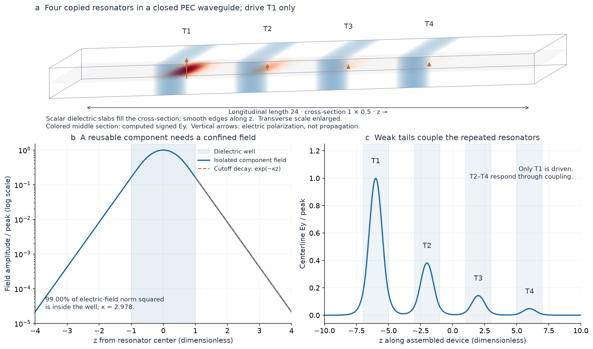
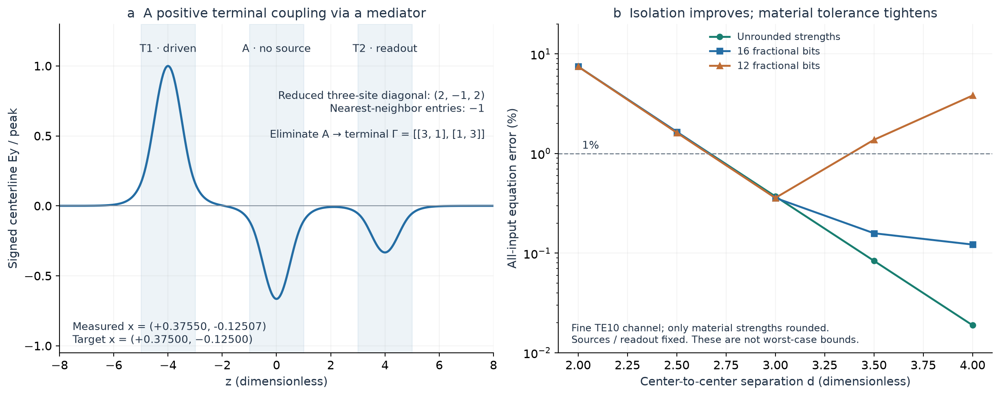

# From one local resonator to a prescribed matrix

The advance is that a design rule transfers between assembled devices. One isolated component supplies a mode and a resonance parameter. An analytic coupling law and the desired matrix then determine the material strengths. The assembled devices receive no whole-device optimization. Different target matrices still require different strengths; changing only the right-hand side changes the source amplitudes, with the dielectric and decoder fixed.

This is a numerical demonstration for a restricted waveguide family. It supports the paper's local-resonance mechanism while using a simpler confinement mechanism than the continuum theorem.



The outer box is a perfectly conducting boundary. Each blue region is a smooth dielectric slab spanning the entire transverse cross-section, rather than a ball, a metal partition or a separate box. The material is uniform in x and y and varies smoothly in z. The displayed transverse dimensions are enlarged; the actual four-site device is 1 × 0.5 × 24 in dimensionless units. There are no internal metal walls.

The cross-section fixes the TE10 electric polarization in the y direction, with a sine profile across x. Between the wells the longitudinal field is evanescent: it decays instead of propagating. The well supports a localized resonance, while the small tails provide coupling to its neighbors. This use of rectangular-waveguide cutoff is standard physics; see [Staelin's MIT lecture, pages 2–5](https://ocw.mit.edu/courses/6-013-electromagnetics-and-applications-spring-2009/MIT6_013S09_lec16.pdf). The isolated calibration puts 99.00% of the unweighted electric-field norm squared inside the well. This is not an electromagnetic-energy fraction.

The full-vector field is solved for each basis source. Positive and negative colors indicate the sign of a frequency-domain electric-field phasor or signed source, not intensity. Vertical arrows show electric polarization, not propagation or energy flow. The plots do not model a transient settling process.

## What the compiler does

For the ordinary chain cases, the prescribed matrix has nearest-neighbor entries −1. With isolated parameter μ and nearest-pair coupling t, the strength rule is

`v_i = 1 / (μ + t Γ_ii)`.

The effective diagonal detuning is therefore `(1/v_i − μ)/t = Γ_ii`, while the nearest-neighbor interaction is normalized to −1. The approximation neglects longer-range interactions and other local modes; the archived Maxwell verification measures the resulting error. The peak permittivity is `1 + v_i/e`, about 13.64, even though the bump coefficient v is about 34.36.

Input b determines the volume source `f = t B V b`. The answer is a signed local measurement plus a known input contribution: `x = t V b + V B.T E`. An intensity measurement alone would lose the sign. B contains translated copies of the same calibrated smooth source function; V contains the terminal strengths. Neither the source program nor the decoder solves or inverts Γ.

The walkthrough includes the five original targets and the additional spacing-3 four-site chain. The five original targets all have less than 0.55% equation error on both finer full-vector grids; the metric `||ΓX−I||₂` covers every input. The interactive readout instead reports the equation error for the currently selected input, which may be smaller. The reference answer is computed only afterward for comparison.

## Why the mediator and precision examples matter



The mediator starts with three reduced diagonal entries `(2,−1,2)` and nearest-neighbor entries −1. Eliminating the unforced center gives the terminal matrix `[[3,1],[1,3]]`. For `b=(1,0)`, the measured answer is approximately `(0.37550,−0.12507)`, close to `(0.375,−0.125)`. The negative reduced diagonal and answer coexist with entirely positive scalar permittivity. This illustrates a useful algebraic operation implemented through an auxiliary resonator; it does not establish arbitrary signed graphs.

More separation improves isolation and reduces omitted interactions. It also weakens the useful interaction, so a fixed material-setting error becomes more consequential. For the four-site fine-channel calculations, moving from spacing 3 to 4 reduces the nominal equation error from 0.3714% to 0.0189%. Rounding strengths to 12 fractional bits instead gives 0.3585% and 3.8246%. At spacing 4, 16 fractional bits gives 0.1220%. Only the material was rounded; source functions and decoder gains remained nominal. These are measured examples, not worst-case tolerance bounds, and occasional error cancellation explains why rounding can slightly improve a particular result.

## What this adds to the paper

- **A working example of composition.** Local characterization plus a formula predicts several assembled devices, including an indefinite target and a mediator, without fitting their final response.
- **A control for the experimental pipeline.** Source programming, full-vector solution, signed readout, mesh refinement and a fixed-design wall-extension test agree in a platform with strong confinement. Together with the periodic-platform failures, this supports investigating physical locality rather than assuming that more global fitting establishes a reusable compiler.
- **A concrete view of the precision cost.** Removing whole-device trial and error does not remove the need for accurate material settings.

The current continuum theorem uses a selected local Bloch-band minimum and full-operator residual control, without assuming an invariant physical sector. This experiment deliberately has an exact transverse sector. It therefore does not reproduce the theorem's general three-dimensional routing or its difficult leakage estimates. The failed compact periodic examples do not satisfy the theorem's sufficient scales and do not refute its guarantees.

These are small chain systems, already easy to solve numerically. The experiment establishes no general sparse-system compiler, computational advantage, fabricated device, or asymptotic precision bound. Loss, wall conductivity, geometric errors and physical source/readout hardware remain outside this simulation. A reusable junction that survives assembly into branching or cyclic networks is the next substantive bridge; longer chains alone would not establish it.

## Data, visual checks and reproduction

The [mechanism PDF](waveguide_mechanism.pdf) and [mediator/precision PDF](waveguide_sign_and_precision.pdf) are standalone exports. All fields and measurements derive from archived results under `results/local_compilation/waveguide_*`. No new Maxwell solves, optimization or retuning were performed to make these illustrations.

The interactive section is reconstructed from the saved full-vector Ey centerline and its TE10 transverse profile. Before exporting, the generator checks that reconstruction against the original three-dimensional field; the maximum relative difference is below `5.1e-14` across the six cases. It also checks source programming and recomputes the decoder from all components on the original grid. Downsampled/rounded display data never enter the numeric readout. [visualization_evidence.json](visualization_evidence.json) records the raw-field and design hashes and these checks. [browser_checks.json](browser_checks.json) records 75 numeric interactions, 736/360/320-pixel viewport checks, dark appearance and saved-state restoration; the rendered views were also visually inspected.

From the repository root:

```bash
uv run --script experiments/visualize_waveguide.py \
  --inline-output /absolute/path/to/waveguide-local-compiler.html
```

The literal interactive template is `experiments/waveguide_walkthrough.html`. The optional browser check uses the preview generated by the visualization renderer at `report/local_compilation/walkthrough/preview.html`:

```bash
uv run --script experiments/check_waveguide_visual.py
```
